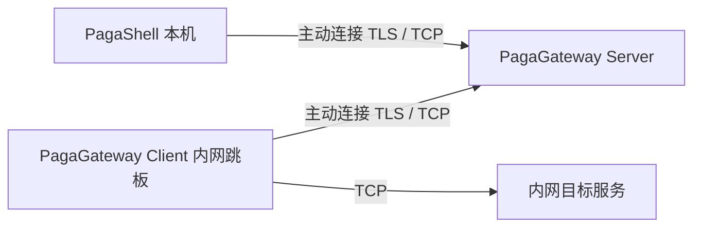

# Page 网关

Page 是 PagaShell 的自定义 TCP 中转类型，配套 Go 项目为 [PagaGateway](https://github.com/mingdraw/PagaGateway)，两个独立 GitHub 仓库通过 **Page v1** 协议关联。它参考反向代理的控制连接/工作连接设计，不兼容 frps/frpc 的线协议。

## 网络路径



本机与目标网络不互通时，将 Server 部署到双方都能访问的机器；Client 部署到能访问内网目标的机器。只有 Server 监听中转端口，示例 `7443`。本机内置协议，不再运行 Go Client。没有共同可达的 Server 时无法连接。

## 配置对应

先按 [PagaGateway 部署说明](https://github.com/mingdraw/PagaGateway#快速部署) 启动 Server 与 Client，再创建 Page 网关：

| PagaShell 字段 | PagaGateway 对应 |
|---|---|
| 网关类型 | Page |
| 中转 Server 地址、端口 | Server `listen` 的可访问地址，Client 的 `server` |
| Client ID | Server `routes[].id` = Client `id` |
| Server 证书 SHA-256 指纹（可选） | TLS 模式填 `pagagateway certificate` 输出，与 Client `server_fingerprint` 一致；无证书 TCP 模式留空 |
| 访问令牌 | Server 对应 `routes[].access_token` 的值 |
| 服务地址和端口 / 转发目标地址和端口 | Client `allowed_targets` 中完整的内网目标地址和端口；配置 `["*"]` 时可填写任意 Client 网络可达的目标 |

Server 的 `client_token`、`access_token` 和 Client 的 `token` 直接填写令牌值，不使用环境变量；Client 的 `token` 须与 Server 对应 route 的 `client_token` 相同。令牌须非空，不单独限制长度。访问令牌与 Client 注册令牌须不同，建议使用随机值，PagaShell 仅持有访问令牌。TLS 模式中，指纹须通过可信渠道核对；证书更换后同步更新两端。两条到 Server 的链路使用 TLS 1.3，固定证书指纹替代 CA、名称与有效期校验。

### 无证书 TCP / IP 直连

Server 同时省略 `cert_file`、`key_file` 或将两项设为空，Client 的 `server_fingerprint` 省略或留空。PagaShell 的中转地址可直接填写 Server IP，指纹留空即使用未加密 TCP，注册与访问令牌仍然必填。仅缺少一个证书字段会报错。PagaGateway 提供 `examples/server-tcp.json` 与 `examples/client-tcp.json`，前台 `run` 和后台 `start` 都支持这种模式。

> WARNING: TLS is disabled. Traffic and tokens are sent in plaintext, and the server identity is not verified. Use only on trusted networks.

上述英文风险提示仅由 PagaGateway Server 在无证书模式启动时输出，后台模式同时显示在 Server 的启动或重启命令输出和服务端日志中。两端模式须匹配；指纹非空时严格使用 TLS，校验失败不会降级为明文。目标 SSH 密钥和 RDP 证书审核继续生效。

Page 表单不使用 SSH 用户名或凭证选择器；令牌仅存于原有 SecretStore/保险库，编辑留空保留。非敏感配置存于 SQLite 中，现有 SSH 网关、桌面服务与绑定保留，旧 RDP 网关继续停用。

服务的高级选项中选择 Page 网关，目标用户名和密码/私钥仍维护在服务或凭证中。Page 先建立字节流，再运行原有目标身份核验及认证。SSH 终端、SFTP、状态采集和 RDP / VNC 均可使用；每个目标会话独立持有连接，关闭会话释放通道。任何中转错误都不会回退直连。

### 网关端口转发

右键 Page 网关选择「端口转发」，填写「本地端口 → 目标 IP 或域名:目标端口」并启动。无需创建或登录目标 SSH 服务，目标由内网 Client 连接；`127.0.0.1` 指 Client 本机。映射自动保存在网关下，升级时清除旧服务上的映射。

本地监听所有 IPv4 网卡，全部端口绑定成功后显示「正在监听」。每条本地连接通过 Page 独立鉴权并访问目标；目标须符合 Client 的 `allowed_targets`。令牌、Client 状态或目标连接有误时，本次连接报错并关闭，监听仍保留供后续重试；不回退本机直连。停止、关闭页签或删除网关时释放监听、活动连接和正在建立的中转流。

### 网关动态代理

右键 Page 网关选择「动态代理」，可启用 HTTP(S)、SOCKS5 并设置本机监听端口；HTTP(S) 同时支持 HTTP 请求和 HTTPS CONNECT。全局或规则命中的请求通过 Page 自有 TCP 通道，由内网 Client 访问原始域名及端口，保留 HTTPS 网站的 TLS/SNI；无需 Client 运行 SSH。目标继续受 `allowed_targets` 限制。直连模式与未命中的规则请求由 PagaShell 本机连接。详细行为见 [动态代理](dynamic-proxy.md)。

## 验证

Go 测试覆盖 TLS / 无证书 TCP 的鉴权、目标允许列表、二进制与半关闭，以及并发、断线和重连。跨仓库测试分别使用两种模式启动真实 Go Server/Client，并验证 Rust SSH 指纹门禁、认证、SFTP 规范化目录、取消/清理，以及 RDP TLS/NLA 在发送凭据前停于证书审核：

```sh
# 在 PagaGateway 构建：
go build -o /tmp/pagagateway ./cmd/pagagateway
# 在 PagaShell/rust 运行：
PAGAGATEWAY_BIN=/tmp/pagagateway cargo test --lib page_go_relay -- --ignored
```

以上为本机回环测试。真实跨网连接、实际 Windows 桌面登录与长期运行需在部署环境验收；跨平台交叉编译成功也不等同于三种平台均已原生运行验证。

### 2026-10-22 本地验证记录

- Go `vet`、`test -race` 通过；Linux/macOS/Windows × amd64/arm64 六个包构建成功。
- Rust `fmt`、全部目标 `clippy -D warnings` 通过；常规测试 55 通过、3 个显式环境测试跳过；其中 2 项 Page 跨仓库测试已单独运行并通过。
- Flutter 静态分析通过；网关、数据库和会话相关测试 173 通过、4 跳过；macOS Debug 构建通过。英文 800×600 Page 表单已检查。
- 完整 Flutter 套件为 506 通过、4 跳过、5 失败。失败集中在 `ui_layout_test.dart` 的菜单键盘高亮断言和密码框高度断言（30/33）；未将全套测试标记为通过。
